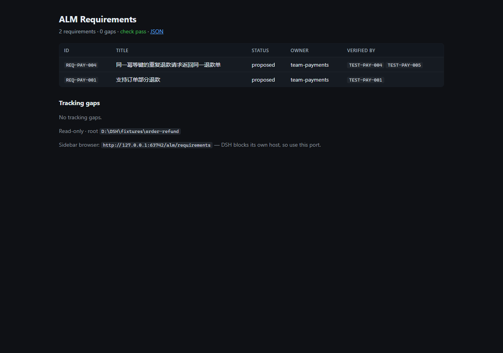
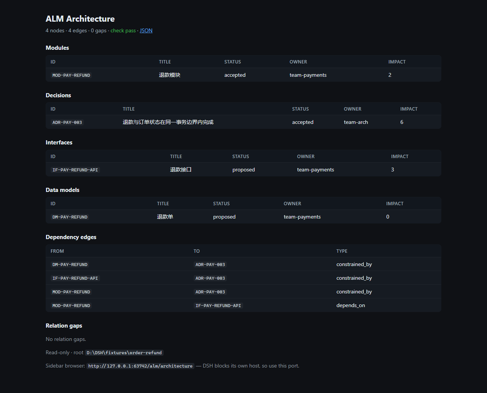

# 验证报告

- 版本：`alm 0.1.0` ｜ 规则包 `1.1.0` ｜ 契约 `alm.*/v1`
- 分支：`develop` @ `2c30149`（ALM-06.01 合并后）
- 日期：2026-10-23
- 关联：[架构](architecture.md)、[任务拆解](task-breakdown.md)、[权限模型](../development/permissions.md)、[升级与兼容](../development/upgrade.md)、[恢复手册](../development/recovery.md)

## 1. 结论

| 项 | 结果 |
|---|---|
| 单元 / 集成 / 插件测试 | **127 通过，0 失败** |
| 契约自检 | `contracts: ok` |
| 技能一致性 | 5 个技能（1 开发 + 4 产品）通过；CI 执行 |
| 三次变更演练 | **3/3 通过，21 个步骤**，无失败步骤 |
| Playwright UI 验证 | **28/28 通过**（本地服务与运行中的 DSH 宿主各一次） |
| 样例仓库门禁 | `check: pass`（`STATE-001`/`REN-002`/`APPROVAL-*` 按预期 `skip`） |

MVP 的“改资产 → 门禁 → 差异/影响 → 基线 → 发布/回滚”回路在本地可复现，且有 UI 级证据。

## 2. 环境

| 项 | 值 |
|---|---|
| Node | 26.7.0（本机）/ 22（GitHub Actions） |
| pnpm | 10.30.3 |
| 平台 | win32 x64（本机）；`alm-core` job 为 ubuntu-latest |
| 宿主 | DeepSeek Harness 44.7.0 Desktop，Web `http://127.0.0.1:60860` |
| 浏览器 | Playwright 1.64.1 + 系统 Chrome（捆绑 Chromium 缺失时回退） |

## 3. 命令矩阵

| 命令 | 期望 | 实际 | 退出码 |
|---|---|---|---|
| `alm --version` | `0.1.0` | `0.1.0` | 0 |
| `alm contract verify` | 五类契约有效 | `contracts: ok` | 0 |
| `alm check --root fixtures/order-refund` | `pass` | `check: pass`（`STATE-001`/`REN-002`/`APPROVAL-*` = `skip`） | 0 |
| `node --test "packages/*/test/**/*.test.mjs"` | 全绿 | 127 pass / 0 fail | 0 |
| `node scripts/check-alm-skill.mjs` | 全部技能与 CLI/工具一致 | 5 个技能 ok | 0 |
| `scripts/validate-skills.ps1` | `.dsh/skills` 合法 | 3 个技能通过 | 0 |
| `node scripts/demo-init.ps1 -Force` | 生成样例仓库 | `tmp/demo-order-refund` + 基线 SHA | 0 |
| `node scripts/drill.mjs` | 三次演练通过 | 3 drills / 21 steps | 0 |
| `node scripts/ui-verify.mjs` | 页面断言全绿 | 28/28 | 0 |
| `node scripts/ui-verify.mjs --base http://127.0.0.1:60860` | 宿主页面一致 | 28/28 | 0 |
| `node scripts/ui-verify.mjs --require REQ-PAY-999` | 断言失败 | `FAIL required text "REQ-PAY-999"` | 1 |
| `GET /alm/requirements` | 200 HTML | 200 `text/html` | — |
| `GET /api/alm/requirements` | 200 `alm.requirements/v1` | 200 JSON | — |

## 4. 三次变更演练

`node scripts/drill.mjs --out tmp/drills`（一次性副本 `tmp/drills/repo`，种子 `fixtures/order-refund` @ `d7cb97b9`）：

| 演练 | 内容 | 步骤 | 耗时 | 结论 |
|---|---|---|---|---|
| A | 建工作区 → 新增 `REQ-PAY-002`/`TEST-PAY-002` → `check --base` → `diff` → `impact` → 证据 | 6 | 11379 ms | pass |
| B | 注入悬空关系 → `check` 失败（`REL-001`）→ 修复 → 通过 | 3 | 4014 ms | pass |
| C | `baseline create` ×2 → `publish` ×2 → `verify` → `rollback` → `verify`；`publish`/`ci run` 重复返回 `unchanged` | 12 | 24862 ms | pass |

指标（`tmp/drills/report.json`）：

| 指标 | 值 | 说明 |
|---|---|---|
| 总耗时 | 40255 ms | 三演练步骤 + UI 检查 |
| 人工介入 | 0 | 全自动执行 |
| AI 建议采纳率 | 未采集 | 需评审人逐条打分，不估算 |
| 漏检 / 误报 | 未采集 | 需与期望结果人工比对，不估算 |

## 5. UI 级验证（Playwright）

每次演练结束后跑一次 UI 验证（需求页、架构页、`/api/alm/*`），断言：HTTP 200、标题、表头、资产行、缺口区、`·` 分隔符、无乱码、无 console error、无 4xx/5xx 资源。





- 截图来源：`tmp/drills/ui-a/`（B、C 同结构），已归档到 `docs/assets/verification/`。
- 对运行中的 DSH 宿主（真实端口 60860）同样 28/28，说明插件路由与页面在宿主上可用。
- 负例：`--require REQ-PAY-999` 退出 1，证明断言失败会让流程失败。

### 按需 CI：`alm-ui.yml`

PR 流程不跑浏览器；需要可归档的 UI 证据时手动触发：

```bash
gh workflow run alm-ui.yml --ref develop                       # 默认 fixtures/order-refund
gh workflow run alm-ui.yml --ref develop -f require=REQ-PAY-999  # 负例：run 必红
gh run download <run-id> -n ui-report -D tmp/ui-ci             # report.json + 两张 PNG
```

- workflow 安装 Chromium 与 `fonts-noto-cjk`（中文截图可读），artifact `ui-report` 保留 7 天。
- job summary 由 `scripts/ui-summary.mjs` 生成，列出检查总数、失败项与截图名。
- 失败时 `if: always()` 仍上传 artifact，日志保留 `FAIL` 行。
- 真实 run：[正例 40029431006](https://github.com/peterzhanghao/AI_ALM/actions/runs/40029431006)（28/28，artifact 119939 B，CI 截图中文正常）；[反例 40029678878](https://github.com/peterzhanghao/AI_ALM/actions/runs/40029678878)（`FAIL required text "REQ-PAY-999"`，artifact 仍上传 119967 B）。

## 6. 已知缺口

| 缺口 | 影响 | 现状 / 承接 |
|---|---|---|
| Gitea 适配器 | 只能本地 git 与 GitHub 工作流 | `alm-scm` 预留接口，未接入 CLI；ALM-04.06 实现客户端与 mock 测试 |
| 侧边栏浏览器禁止同端口 loopback | 打开 DSH Host 端口的 `/alm/*` 显示空白（Desktop guest 的 `isApplicationHost`，导航 `ERR_FAILED`） | 插件 sidecar 端口 `:60870` / `:60871`；或 `node scripts/serve-alm-pages.mjs`（`:60872`），见 [usage](../usage.md) |
| PR 流程不跑 UI 测试 | 浏览器下载与时长不适合每次 PR | `alm-ui.yml` 按需手动触发（Chromium + CJK 字体、artifact）；PR 仍只跑 4 个无浏览器测试 |
| `REN-002` 需要 StrictDoc | 未安装时 `skip` | `scripts/strictdoc-render.ps1` 隔离 venv，`strictdoc==0.30.4` |
| `STATE-001` 需要 `--base` | 无基线时 `skip` | 门禁命令一律带 `--base`，报告里标注 |
| 采纳率/漏检/误报 | 指标不完整 | 标注“未采集”，不估算 |
| 本仓库自身不是资产仓库 | 在仓库根跑 `alm check` 会把 `docs/*.md` 当资产（缺 frontmatter → `FMT-001`） | 检查一律指定资产仓库根（`fixtures/order-refund`、演练副本） |
| Windows-only 脚本 | `demo-init.ps1`、`strictdoc-render.ps1`、`validate-skills.ps1` | CI 只在 Linux 跑 node 部分；需要时补跨平台脚本 |

## 7. 从零复现

```powershell
# 前置：node ≥ 22、pnpm 10、git
pnpm install --frozen-lockfile

node packages/alm-core/bin/alm.mjs contract verify
node --test "packages/*/test/**/*.test.mjs"
node scripts/check-alm-skill.mjs

# 样例仓库与门禁
powershell -NoProfile -ExecutionPolicy Bypass -File scripts/demo-init.ps1 -Force
node packages/alm-core/bin/alm.mjs check --root tmp/demo-order-refund --base HEAD

# 演练 + UI 验证（需要 Chrome 或 `pnpm exec playwright install chromium`）
node scripts/drill.mjs --out tmp/drills
node scripts/ui-verify.mjs --root fixtures/order-refund --out tmp/ui
node scripts/ui-verify.mjs --base http://127.0.0.1:60860 --out tmp/ui-host
```

## 8. 复核记录

| 日期 | 复核人 | 结论 | 备注 |
|---|---|---|---|
| 2026-10-23 | Agent（自动采集） | 通过 | 119 测试、21 演练步骤、28×2 UI 检查 |
| 2026-10-24 | Agent（自动采集） | 通过 | 127 测试（+8 Gitea 适配器）；`alm-ui.yml` 正例 run 28/28、反例 run 按预期失败；Gitea 客户端未接 CLI |
| 待填 | 人工评审 | 待评审 | 需确认“采纳率/漏检/误报”口径后补数据 |
